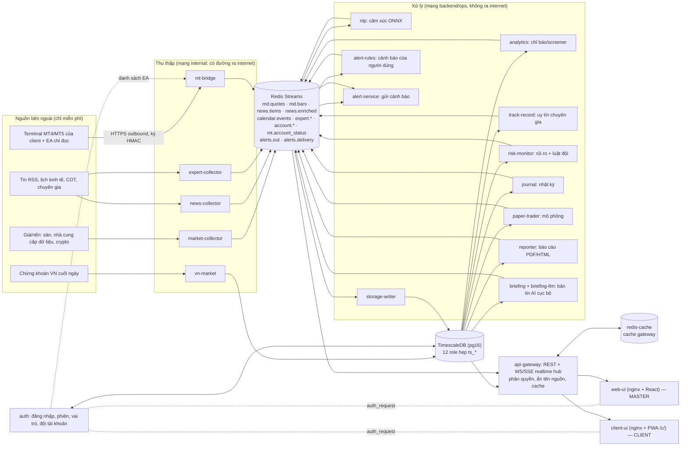
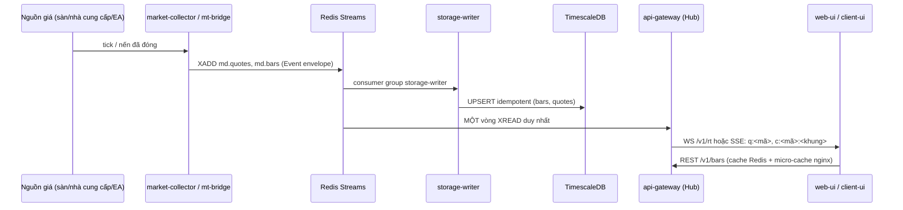
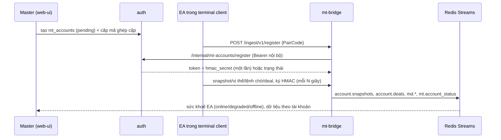

# KIẾN TRÚC HỆ THỐNG (tradingsys) — bản hợp nhất

Cập nhật: 2026-10-14. Đã đối chiếu với VPS <VPS_IP> (project compose `tradingsys`, `docker ps`, `docker network inspect`): **36 container, cả 36 đang chạy** (chi tiết ở §5; docker-socket-proxy, dozzle, gatus không có healthcheck docker — xem HARDENING.md).
Tài liệu này là **bản đồ tổng**; chi tiết từng phần nằm ở các tài liệu chuyên đề (liên kết ở cuối mỗi mục, mục lục đầy đủ: [INDEX.md](INDEX.md)).

> Hệ thống là ứng dụng **master** hỗ trợ các **client** (mỗi client = một tài khoản MT4/MT5). Giai đoạn hiện tại: **chỉ đọc (read-only) + mô phỏng (paper)**. Không có đường nào đặt/sửa/đóng lệnh trong mã (có test `test_no_trading_code_anywhere`, `test_gateway_is_read_only`).

---

## 1. Sơ đồ thành phần



Giải thích ngắn:
- **Một chiều và rõ ràng**: collector → bus → (storage-writer → DB) → các service phân tích đọc DB → gateway → hai giao diện. Service **không đọc DB của nhau** trừ qua API/bus (trừ storage-writer ghi và các service đọc bằng role chỉ-đọc `ts_ro`).
- **EA luôn gọi ra** (outbound HTTPS tới `mt-bridge`); máy chủ không mở cổng vào máy của client và **không nhận mật khẩu MT** của ai.
- **Phân quyền ở một chỗ**: nginx hỏi `auth` ("ai đây?") rồi gắn danh tính tin cậy cho `api-gateway`; gateway quyết định client được xem gì (whitelist, lọc theo `account_id`).

Chi tiết: [CONTRACTS.md](CONTRACTS.md) (luồng sự kiện), [AUTH.md](AUTH.md), [CLIENT_PLATFORM.md](CLIENT_PLATFORM.md), [REALTIME.md](REALTIME.md), [PERFORMANCE.md](PERFORMANCE.md).

---

## 2. Luồng dữ liệu chính

### 2.1 Giá (quote và nến)

- Hub trong gateway gộp nhiều nguồn thành một quote chuẩn theo ưu tiên (`RT_SOURCE_PRIORITY`), đánh dấu "cũ" sau 20 s, báo "im lặng" sau 90 s. Nến đang hình thành do EA gửi, cập nhật theo từng tick. Xem [REALTIME.md](REALTIME.md); thứ tự ưu tiên nguồn: [DATA_SOURCE_PRIORITY.md](DATA_SOURCE_PRIORITY.md).
- **Feed canon (2026-10-14, nến FX/vàng/chỉ số gần realtime)**: mt-bridge (`services/mt-bridge/src/mtbridge/feed.py`) lấy nến M1 ĐÃ ĐÓNG mà EA của tài khoản feed (`FEED_CANON_ACCOUNT=mt5:100000001`, MetaQuotes-Demo, investor, READ-ONLY) gửi cho `FEED_CANON_SYMBOLS` (EURUSD, GBPUSD, USDJPY, XAUUSD, US500, US30, USTEC) và phát lại trên `md.bars` với `source='canon:mt5:100000001'`: M1 ngay (trễ ~1–2 phút), M5/M15/H1/H4/D1 gộp từ M1 theo **mốc UTC** (đúng hợp đồng md.bars, không theo giờ server EET), chỉ khi bucket **đã đóng và được quan sát trọn** từ đầu phiên. Mọi đường đọc dùng `DISTINCT ON (ts_open) ... ORDER BY source` (gateway `_dedupe_bars` xếp `canon` đầu) ⇒ ở mỗi `(symbol, tf, ts_open)` có nến canon thì canon thắng, không có thì rơi về nguồn cũ (dukascopy trễ 80–100 phút). **Chọn nguồn theo khoảng thời gian, không trộn trong một nến**: phút không có tick trong phiên EA → nến phẳng v=0 (≤ `FEED_FILL_MAX_MIN`=5 phút); EA offline > `FEED_STALE_S`=300 s mà dữ liệu không liền mạch → phiên mới, các bucket dở dang không phát (fallback cho đúng bucket đó). Nến EA THÔ chỉ phát `MT_BAR_TFS=M1,M5,M15,H1` (H4/D1 của EA cắt theo giờ server → lệch mốc, xen kẽ chuỗi). Giới hạn: `v` của canon = tick volume MT5 (khác thang dukascopy); giá demo MetaQuotes lệch dukascopy trung bình <0,2 bps (M1 close); restart mt-bridge làm mất bucket đang chạy (H4/D1 hôm đó dùng nguồn cũ). **Rollback**: `FEED_CANON_ENABLED=false` (infra/.env) + `bash infra/ops/deploy_local.sh mt-bridge`, rồi `DELETE FROM bars WHERE source LIKE 'canon:%'`; raw H4/D1: `MT_BAR_TFS=M1,M5,M15,H1,H4,D1`. Trạng thái: [handoff/FEED_status.md](handoff/FEED_status.md).
- Cache nhiều tầng (T1 Redis gateway, T2 micro-cache nginx, T3 `auth_request`, T4 ETag/Cache-Control, T5 DB): [PERFORMANCE.md](PERFORMANCE.md). **Không bao giờ cache chéo người dùng.**

### 2.2 Tin tức → cảm xúc → bản tin
`news-collector` (RSS, lịch, COT) → `news.items` → `nlp` (FinBERT/ViSoBERT ONNX int8 trên CPU, từ điển dự phòng) → `news.enriched` (cảm xúc, mã, chủ đề, mức quan trọng) → `storage-writer` → DB. `briefing` đọc dữ liệu có đánh số, nhờ `briefing-llm` (llama.cpp, mô hình Qwen3.5-9B, **không có internet, không có công cụ**) tóm tắt; kết quả bị **hậu kiểm tất định** (mọi ý phải trích dẫn được số/mã tham chiếu) và lịch chạy 06:15 / 16:30 giờ VN. Chi tiết: `services/briefing/README.md`, [MARKET_INTEL.md](MARKET_INTEL.md).

### 2.3 Tài khoản MT (client)

Bridge poll `auth` mỗi ~10 s, cache 15 s, thu hồi tức thì qua `/internal/invalidate`; `auth` chết → dùng cache tối đa 10 phút rồi **fail-closed**. Chi tiết: [CLIENT_PLATFORM.md](CLIENT_PLATFORM.md), `mt-agent/README.md`.

### 2.4 Cảnh báo
Nguồn phát `alerts.out` (mọi service + Alertmanager + Gatus) → `alert-service` (dedupe, rate-limit, **lọc tên nguồn**, gửi ntfy/Apprise/Telegram, phát `alerts.delivery`) → `storage-writer` lưu → UI hiển thị. Cảnh báo **do người dùng đặt** chạy ở `alert-rules` (đánh giá trên `md.quotes` + DB; dữ liệu cũ/thiếu = "không rõ", không kích hoạt), mỗi luật thuộc về một chủ sở hữu.

### 2.5 Báo cáo
`reporter` (cron 06:30 ngày, Chủ nhật 19:00 tuần, giờ VN) chỉ **GET** qua gateway → Jinja2 → HTML tự chứa + PDF (WeasyPrint); mục thiếu dữ liệu ghi "Chưa có dữ liệu" (degraded); chạy `scrub_obj` để bỏ tên nguồn. Báo cáo theo khách và theo lịch dùng danh sách tài khoản từ `auth` (`/internal/fleet/scope-accounts`).

### 2.6 Chuyên gia → uy tín → đồng thuận
`expert-collector` → `expert.*` → DB. `track-record` trích quan điểm có hướng (tin, tín hiệu, COT), chấm theo lợi suất thật với chống nhìn-trước (look-ahead), xếp hạng chỉ khi n ≥ 30, hiệu chỉnh đa kiểm định; ghi vào sổ cái hash-chain `tr_views`. Kết quả hiện tại thật thà: **chưa chuyên gia nào vượt baseline ngẫu nhiên**. [EXPERT_TRACKRECORD.md](EXPERT_TRACKRECORD.md).

### 2.7 Quản trị đội tài khoản (master)
`auth` giữ nhóm/tag/mẫu luật/sự cố/vai trò phụ; `risk-monitor` lấy luật qua `/internal/fleet/rules`, đo bằng equity từ DB và trả kết quả/điều kiện sự cố qua `/internal/fleet/results` (token nội bộ `FLEET_INTERNAL_TOKEN`). [FLEET_MGMT.md](FLEET_MGMT.md).

---

## 3. Mạng và bảo mật

Năm mạng Docker (đã kiểm `docker network inspect`):

| Mạng | `internal` | Dùng cho | Có đường ra internet? |
|---|---|---|---|
| `backend` | **có** | DB, Redis, Redis-cache và service cần chúng | Không |
| `ops` | **có** | HTTP nội bộ giữa service, metrics, Prometheus/Alertmanager | Không |
| `frontend` | không | Cổng publish `127.0.0.1` (web-ui, client-ui, gateway, grafana, gatus, ntfy, jaeger, auth) | Chỉ khi container khác nối |
| `internal` | không | Chỉ service **cần internet** (collector ×3, alert-service, nlp, vn-market) + mt-bridge + prometheus + alert-rules | Có |
| `socketproxy` | không | Chỉ cadvisor, dozzle ↔ docker-socket-proxy (chỉ GET) | Không |

Nguyên tắc bảo mật chính (chi tiết: [HARDENING.md](HARDENING.md), [AUTH.md](AUTH.md), [SECURITY_SCAN.md](SECURITY_SCAN.md)):
- Mọi container: `cap_drop: ALL`, `no-new-privileges`, `read_only`, user không root, giới hạn RAM/CPU/pids. Ngoại lệ có ghi lý do (docker-socket-proxy, cadvisor, textfile-exporter, grafana).
- **Không port nào bind 0.0.0.0**: tất cả `127.0.0.1`; Internet chỉ vào qua **Cloudflare quick tunnel** (`tradingsys-tunnel.service`, host) → web-ui:8580.
- Redis ACL: `ts_app` (service), `ts_gateway` (chỉ đọc), `ts_admin` (ops), `ts_cache` (chỉ `cache:*`), `ts_metrics`.
- DB: 12 role hẹp (`ts_ro`, `ts_writer`, `ts_auth`, `ts_mtauth`, `ts_analytics`, `ts_paper`, `ts_journal`, `ts_vn`, `ts_userconf`, `ts_trackrec`, `ts_briefing`, `ts_monitor`); superuser `ts` chỉ dùng cho init/backup/migration qua `docker exec`.
- Secret: mỗi service chỉ nhận biến nó cần (`infra/ops/service_env.manifest`).
- Đăng nhập: phiên cookie `ts_session` (HttpOnly, Secure, SameSite=Strict), argon2id, khoá tạm, TOTP tuỳ chọn (bắt buộc cho thao tác nhạy cảm của master), nginx **đè** header danh tính + `X-Auth-Secret`; gateway mặc định **từ chối** vai trò client trừ whitelist; chống IDOR có test e2e.
- Sao lưu: `pg_dump` mã hoá + base backup vật lý (PITR) + restore-test tự động (timer systemd trên host); xem [DR_RUNBOOK.md](DR_RUNBOOK.md), [DATA_RETENTION.md](DATA_RETENTION.md).
- Giám sát: Prometheus (v3.13) + Alertmanager + Gatus + Grafana + Jaeger (tracing) + Dozzle (log) + ntfy; SLO: [SLO.md](SLO.md), [OBSERVABILITY.md](OBSERVABILITY.md).

---

## 4. Nguyên tắc thiết kế

| # | Nguyên tắc | Hệ quả cụ thể |
|---|---|---|
| 1 | **Chỉ đọc trước, thực thi sau** | Không có mã đặt lệnh; kênh lệnh chỉ nằm trong thiết kế ([CONTROL_PLANE_DESIGN.md](CONTROL_PLANE_DESIGN.md)) sau cổng pháp lý G1–G3 |
| 2 | **Paper trước live** | Mô phỏng bằng tiền ảo, hash-chain, tiêu chí lên bậc tự đặt, không có bước tự động sang tiền thật |
| 3 | **Không bao giờ thu mật khẩu giao dịch/investor MT** | Client chỉ cài EA; EA chỉ gửi ra |
| 4 | **EA chủ động đẩy ra (outbound)** | Không mở cổng vào máy client/VPS |
| 5 | **Bus là hợp đồng** | Service giao tiếp qua Redis Streams + HTTP API gateway; hợp đồng ở CONTRACTS.md |
| 6 | **Quyền tối thiểu** | Role DB hẹp, Redis ACL, secret theo service, container read-only |
| 7 | **Thà im lặng còn hơn sai** | Dữ liệu cũ/thiếu không kích hoạt cảnh báo; mẫu ngắn hiện "n/a/chưa đủ mẫu"; mất `auth` → fail-closed |
| 8 | **Ẩn tên nguồn dữ liệu trên mọi giao diện** | Bộ lọc trung tâm `tscommon.sources` ở gateway/alert/reporter/UI ([UI_NO_SOURCES.md](UI_NO_SOURCES.md)) |
| 9 | **Gói 0 đồng** | Chỉ nguồn/công cụ miễn phí ([FREE_STACK.md](FREE_STACK.md)); tích hợp OSS thay vì viết lại ([OSS_REUSE.md](OSS_REUSE.md)) |
| 10 | **Build/test/deploy chỉ trên VPS** | Laptop chỉ sửa file + git; `deploy.sh "<lệnh compose>"` |
| 11 | **Đo trước, tin sau** | Mọi kết luận chiến lược/chuyên gia đi kèm kiểm định, khoảng tin cậy và phần "không đạt" ([research/](research/)) |

Các quyết định lớn có giải thích và hệ quả: thư mục [ADR/](ADR/).

---

## 5. Bảng 36 container (đối chiếu `docker ps` trên VPS, 2026-10-14)

Cổng host chỉ bind `127.0.0.1`. "Cổng nội bộ" = cổng lắng nghe trong mạng Docker. Mọi service Python lắng nghe `8000` (healthz + metrics, Prometheus scrape); một số không khai báo EXPOSE nên `docker ps` không hiện. "DB role" = vai trò Postgres mà service dùng (`—` = không truy cập DB trực tiếp). Mạng viết tắt: **B**=backend, **O**=ops, **F**=frontend, **I**=internal, **S**=socketproxy.

### 5.1 Dữ liệu và bus
| Container | Vai trò | Cổng nội bộ (host) | DB role | Mạng |
|---|---|---|---|---|
| `tradingsys-redis-1` | Redis 8.10 — bus Redis Streams (AOF, ACL, noeviction, 6 GB) | 6379 | — | B |
| `tradingsys-redis-cache-1` | Redis 7.4 — cache gateway (512 MB, allkeys-lru, không lưu đĩa) | 6379 | — | B |
| `tradingsys-timescaledb-1` | TimescaleDB 2.30 / PostgreSQL 16 (giá, tin, tài khoản, kết quả) | 5432 | superuser `ts` (chỉ nội bộ) | B |

### 5.2 Thu thập
| Container | Vai trò | Cổng | DB role | Mạng |
|---|---|---|---|---|
| `tradingsys-market-collector-1` | Giá/nến FX, vàng, ETF/cổ phiếu Mỹ, crypto (ccxt), backfill D1 | 8000 | — | B,I,O |
| `tradingsys-news-collector-1` | Tin RSS, GDELT, lịch kinh tế (forecast/actual), COT | 8000 | — | B,I,O |
| `tradingsys-expert-collector-1` | Hồ sơ/ý kiến/vị thế chuyên gia công khai | 8000 | — | B,I,O |
| `tradingsys-vn-market` | Chứng khoán VN cuối ngày (HOSE/HNX/UPCoM) | 8000 | `ts_vn` | B,I,O |
| `tradingsys-mt-bridge-1` | Nhận dữ liệu EA MT4/MT5 (HMAC), cấp phát động qua auth | 8000 (127.0.0.1:8490) | — (gọi HTTP nội bộ của `auth`) | B,I,O |
| `tradingsys-ai-trading` / `tradingsys-ai-trading-worker` | Tab AI Trading + AI Training Class: API (registry YAML, hồ sơ kịch bản) và worker chạy job backtest nền | 8000 (nội bộ, qua api-gateway `/v1/ai-trading/*`); worker không gắn mạng (network none) | — | backend (worker: none) |
| `tradingsys-pattern-engine` / `tradingsys-pattern-scan` | Engine nhận dạng mẫu hình (spec KB) và quét mẫu hình theo kịch bản | 8000 (nội bộ) | — | backend + ops |
| `tradingsys-data-keeper` | Giám sát phủ dữ liệu 162 mã, vá lỗ dữ liệu (xem mục 9) | 8000 (nội bộ) | — | backend + ops |

Lưu ý tên: container có hậu tố `-1` (do compose đặt) là `market-collector`, `news-collector`, `expert-collector`, `mt-bridge`, `storage-writer`, `risk-monitor`, `reporter`, `alert-service`, `api-gateway`, `web-ui`, `client-ui` và các công cụ prometheus/grafana/...; các container còn lại có tên đúng như bảng (đặt `container_name`).

### 5.3 Xử lý và phân tích
| Container | Vai trò | Cổng | DB role | Mạng |
|---|---|---|---|---|
| `tradingsys-storage-writer-1` | Consume 9+ stream → UPSERT idempotent vào DB | 8000 | `ts_writer` | B,O |
| `tradingsys-nlp` | Cảm xúc/chủ đề/quan trọng (ONNX CPU, en+vi), tối đa 6 GB | 8000 | — | B,I,O |
| `tradingsys-analytics` | Chỉ báo H1/H4/D1 (TA-Lib), screener, tương quan, phiên | 8000 | `ts_analytics` (ghi) + `ts_ro` (đọc) | B,O |
| `tradingsys-track-record` | Uy tín chuyên gia: chấm điểm, hoán vị, BH-FDR, hash-chain | 8000 | `ts_trackrec` + `ts_ro` | B,O |
| `tradingsys-risk-monitor-1` | VaR/ES/stress, margin/drawdown, **luật đội tài khoản** | 8000 | `ts_ro` | B,O |
| `tradingsys-journal` | Nhật ký giao dịch, kỷ luật, MAE/MFE, review tuần | 8000 | `ts_ro` + ghi `journal_notes` | B,O |
| `tradingsys-paper-trader` | Mô phỏng tiền ảo, risk engine, kill-switch, strategy card | 8000 | `ts_paper` + `ts_ro` | B,O |
| `tradingsys-alert-rules` | Cảnh báo/watchlist/thông báo/Web Push của người dùng | 8000 | `ts_userconf` + `ts_ro` | B,I,O |
| `tradingsys-alert-service-1` | Gửi cảnh báo (ntfy/Apprise/Telegram), dedupe, lọc tên nguồn | 8000 | — | B,I,O |
| `tradingsys-reporter-1` | Báo cáo ngày/tuần HTML+PDF, báo cáo theo khách | 8000 | — (gọi gateway) | B,O |
| `tradingsys-briefing` | Bản tin AI có trích dẫn + hậu kiểm tất định | 8000 | `ts_briefing` + `ts_ro` | B,O |
| `tradingsys-briefing-llm` | llama.cpp server (Qwen3.5-9B GGUF), **không internet**, 16 GB | 8080 | — | O |

### 5.4 Truy cập và giao diện
| Container | Vai trò | Cổng nội bộ (host) | DB role | Mạng |
|---|---|---|---|---|
| `tradingsys-auth` | Đăng nhập master/client, phiên, TOTP, đội TK, sự cố, vai trò, audit | 8000 | `ts_auth` | B,F,O |
| `tradingsys-api-gateway-1` | REST + WS/SSE realtime hub, phân quyền, cache, ẩn nguồn | 8000 (127.0.0.1:8480) | `ts_ro` | B,F,O |
| `tradingsys-web-ui-1` | nginx + React: giao diện **MASTER** (terminal 14+ trang) | 8080 (127.0.0.1:8580) | — | F |
| `tradingsys-client-ui-1` | nginx + PWA `/c/`: giao diện **CLIENT** (vi/en) | 8080 (127.0.0.1:8581) | — | F |

### 5.5 Quan sát và vận hành
| Container | Vai trò | Cổng nội bộ (host) | Mạng |
|---|---|---|---|
| `tradingsys-prometheus-1` | Metrics + 17+ luật cảnh báo | 9090 | B,I,O |
| `tradingsys-alertmanager-1` | Định tuyến cảnh báo → alert-service | 9093 | O |
| `tradingsys-grafana-1` | Dashboard (datasource `ts_ro`) | 3000 (127.0.0.1:**3300**) | B,F,O |
| `tradingsys-gatus` | Probe healthz + trang trạng thái | 8080 (127.0.0.1:8590) | B,F,O |
| `tradingsys-dozzle` | Xem log (qua docker-socket-proxy) | 8080 (127.0.0.1:8591) | S |
| `tradingsys-ntfy` | Thông báo đẩy nội bộ (topic `tradingsys-alerts`) | 80 (127.0.0.1:8592) | F,O |
| `tradingsys-jaeger-1` | Tracing OpenTelemetry | 16686 (127.0.0.1:16686), OTLP 4317/4318 | F,O |
| `tradingsys-cadvisor-1` | Metrics container (đọc Docker qua proxy) | 8080 | O,S |
| `tradingsys-docker-socket-proxy` | Proxy docker.sock chỉ GET | 2375 | S |
| `tradingsys-postgres-exporter-1` | Metrics Postgres (role `ts_monitor`) | 9187 | B,O |
| `tradingsys-redis-exporter-1` | Metrics Redis (user `ts_metrics`) | 9121 | B,O |
| `tradingsys-textfile-exporter-1` | Tuổi backup/restore-test/PITR (node_exporter textfile) | 9100 | O |

Tổng: 3 + 5 + 12 + 4 + 12 = **36**. Ngoài project còn có container của hệ thống khác dùng chung VPS (`fbauto-*`, `mtlab-mt4/mt5` — lab MT trong Wine): **không thuộc `tradingsys`, đừng thao tác**.

Thành phần chạy trên **host** (không phải container): `tradingsys-tunnel.service` (cloudflared quick tunnel, ghi URL vào `data/tunnel_url.txt`), các timer `tradingsys-backup`, `-backupwatch`, `-basebackup`, `-restoretest`.

---

## 6. Cấu trúc thư mục mã nguồn

```
README.md, PLAN.md           tổng quan, kế hoạch + cổng pháp lý G1-G3
libs/common/                 tscommon: Event, Bus, sources.py (ẩn nguồn), cấu hình chung
services/<tên>/              20 thư mục (18 service Python + web-ui + client-ui; xem bảng §5); mỗi cái: Dockerfile, pyproject, src, tests, README (riêng auth chưa có README — xem AUTH.md; track-record: CONTRACT.md)
mt-agent/                    EA MQL4 + MQL5 chỉ đọc (Include/MTAgent dùng chung) + lab Wine
infra/                       docker-compose (3 file), db/ (schema + 17 migration + create_*_role.sh), backup/, ops/, prometheus/, grafana/, redis/
tests/e2e/                   kiểm thử đầu-cuối chạy trên VPS
docs/                        tài liệu (INDEX.md là mục lục)
research/                    mã + kết quả nghiên cứu/backtest (chạy trên VPS)
deploy.sh                    triển khai từ laptop: ./deploy.sh "<lệnh compose>"
```

Lệnh triển khai luôn qua `deploy.sh` vì `COMPOSE_FILE=docker-compose.yml:docker-compose.ops.yml:docker-compose.tools.yml` (chỉ chạy file chính sẽ **đảo ngược** các bản nâng cấp image).

## 7. Feed toàn bộ cặp MT5 (2026-10-14)
Mở rộng nguồn quote/nến realtime từ 7 mã canon sang 126 forex + 10 kim loại + 26 chỉ số của MetaQuotes-Demo. EA market-feed (read-only, tài khoản riêng `mt5:<login>-feed`, batch HMAC) -> mt-bridge (đổi giờ server EET -> UTC bằng offset `server_time` vs `ts`, conflate <=1 quote/symbol/batch) -> `md.quotes`/`md.bars` -> storage-writer + hub realtime. Tách biệt với EA/canon 7 mã (không đổi, rollback bằng tắt EA feed). Giám sát: `prometheus/rules_feed.yml`, dashboard `ts-feed-all`, Gatus `feed-all-fx` (docs/OBSERVABILITY.md §7). Backfill native lịch sử: dữ liệu chỉ ở `data/research/patterns/mt5/` (docs/research/PATTERN_DATA.md). Chi tiết thiết kế: `docs/handoff/FEED_ALL_*.md`.

## 8. Tab AI Trading (2026-10-15, đang xây giai đoạn A)
Service `ai-trading` (registry YAML các chiến lược/mô hình, job backtest nền) sau api-gateway `/v1/ai-trading/*`; UI `#/ai-trading` (master) và bản rút gọn read-only cho client. Tái dùng pattern-engine/scan/render/research, paper-trader (sổ hash-chain), track-record, llama.cpp. CHỈ read-only + paper; không có đường lệnh thật. Chi tiết, API, cách thêm kịch bản/mô hình, backlog: [AI_TRADING.md](AI_TRADING.md).

## 9. data-keeper (2026-10-15)
Service giám sát phủ dữ liệu 162 mã x khung; LLM cục bộ chỉ chẩn đoán/tóm tắt (fallback tất định); API `/v1/data/*` qua gateway chỉ master; trang UI "Dữ liệu". Chi tiết: `docs/DATA_KEEPER.md`.
